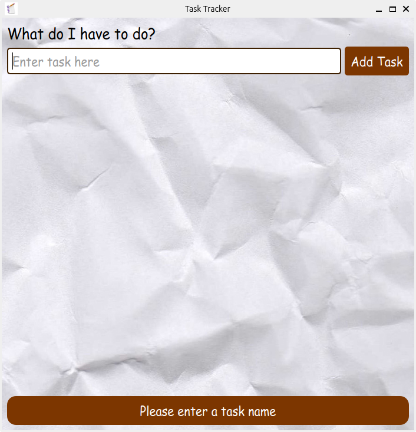

# 📝 Task Tracker

A minimal, custom GUI task tracking app built with **PyQt5**.  
Track your tasks with style — includes toast notifications, autosave to JSON, and a retro-stationery aesthetic.

 <!-- optional, add if you want -->

---

## ✨ Features

- Add, check off, and delete tasks
- Task persistence via `tasks.json`
- Beautiful custom UI with icons and background
- Toast notifications for user feedback
- Cross-platform: Windows, Linux (via PyInstaller)

---

## 🛠 Tech Stack

- Python 3.9+
- PyQt5
- JSON for storage
- PyInstaller (for building executables)

---

## Installation

There are multiple ways to install and run Task Tracker depending on your target platform.

### Local installer (provided)

This project includes a small installer script (`install.sh`) to make the app accessible as a normal desktop application.

Install for the current user (no sudo):

```bash
./install.sh
```

Install system-wide (will use `/usr/local` and require sudo):

```bash
./install.sh --system
```

Files installed by default (user install):
- $HOME/.local/share/task-tracker/ -> application files (copy of `src/`)
- $HOME/.local/bin/task-tracker -> wrapper script to run the app
- $HOME/.local/share/icons/hicolor/256x256/apps/task-tracker.png -> icon
- $HOME/.local/share/applications/task-tracker.desktop -> desktop entry

Notes:
- If you install system-wide you may need to run `sudo update-desktop-database` or log out and back in for the menu to refresh.
- The installer expects `python3` to be available on PATH.

### .deb package (Debian/Ubuntu)

You can build a `.deb` locally using the provided packaging script or the manual steps below.

Prerequisites:
- dpkg-deb (Debian packaging tools)
- fakeroot (to build without root)
- python3 and `python3-pyqt5` installed on target system

Quick build (script):

```bash
chmod +x packaging/build_deb.sh
packaging/build_deb.sh 0.1.0
```

Manual build steps (from repo root):

```bash
# variables
PKG=task-tracker
VERSION=0.1.0
ARCH=all
OUT="${PKG}_${VERSION}_${ARCH}.deb"
BUILD="$(pwd)/build_package"

# create layout
rm -rf "$BUILD"
mkdir -p "$BUILD/DEBIAN"
mkdir -p "$BUILD/usr/share/$PKG"
mkdir -p "$BUILD/usr/bin"
mkdir -p "$BUILD/usr/share/icons/hicolor/256x256/apps"
mkdir -p "$BUILD/usr/share/applications"

# copy files
cp -r src/* "$BUILD/usr/share/$PKG/"
cp resources/th-1828655096.png "$BUILD/usr/share/icons/hicolor/256x256/apps/${PKG}.png" 2>/dev/null || true

# wrapper
cat > "$BUILD/usr/bin/$PKG" <<'EOF'
#!/bin/sh
exec python3 /usr/share/task-tracker/task-tracker_app.py "$@"
EOF
chmod 755 "$BUILD/usr/bin/$PKG"

# desktop entry
cat > "$BUILD/usr/share/applications/$PKG.desktop" <<EOF
[Desktop Entry]
Name=Task Tracker
Comment=A beautiful little to-do app
Exec=/usr/bin/$PKG
Icon=$PKG
Terminal=false
Type=Application
Categories=Utility;Productivity;
EOF

# control
cat > "$BUILD/DEBIAN/control" <<EOF
Package: $PKG
Version: $VERSION
Section: utils
Priority: optional
Architecture: $ARCH
Depends: python3, python3-pyqt5
Maintainer: Your Name <you@example.com>
Description: A small task tracker app built with PyQt5
 A simple to-do application.
EOF

# build with fakeroot
fakeroot dpkg-deb --build "$BUILD" "$OUT"

```

Install the package:

```bash
sudo dpkg -i task-tracker_0.1.0_all.deb
sudo apt-get install -f
```

Notes:
- The packaging script copies `src/` into `/usr/share/task-tracker` inside the package, creates a `/usr/bin/task-tracker` wrapper, installs the icon (if present) to the hicolor icon path, and adds a desktop entry under `/usr/share/applications`.
- Edit dependencies in `packaging/build_deb.sh` (control file) if you need different package names or additional runtime deps.
- Consider adding a GitHub Actions workflow to build and publish `.deb` assets automatically on tags.

---

## 🐧 Install on Linux (Ubuntu/Debian)

You can install Task Tracker with the .deb package:

[](https://github.com/niicommey01/Task-Tracker-App/releases/download/v1.0/task-tracker.deb)

---
## 🖼 Install on Windows (10/11)
[](https://github.com/niicommey01/Task-Tracker-App/releases/download/v1.1/TaskTrackerInstaller.exe)


---

## 📋 License

This project is licensed under the [MIT License](LICENSE).
